<p align="center">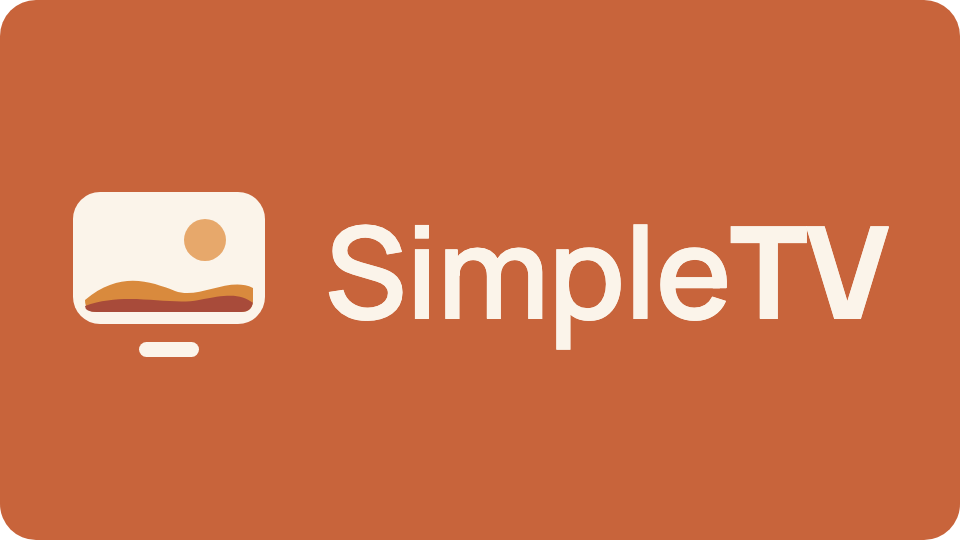</p>

# SimpleTV

A calm, simple home screen for Android TV, built for people who just want to watch
something. It replaces the stock Google TV home screen with big app tiles, a gentle
seasonal backdrop, and nothing else: no ads, no autoplaying trailers, no
recommendation rows. It runs on the **Walmart onn 4K Streaming Device (2026)**.

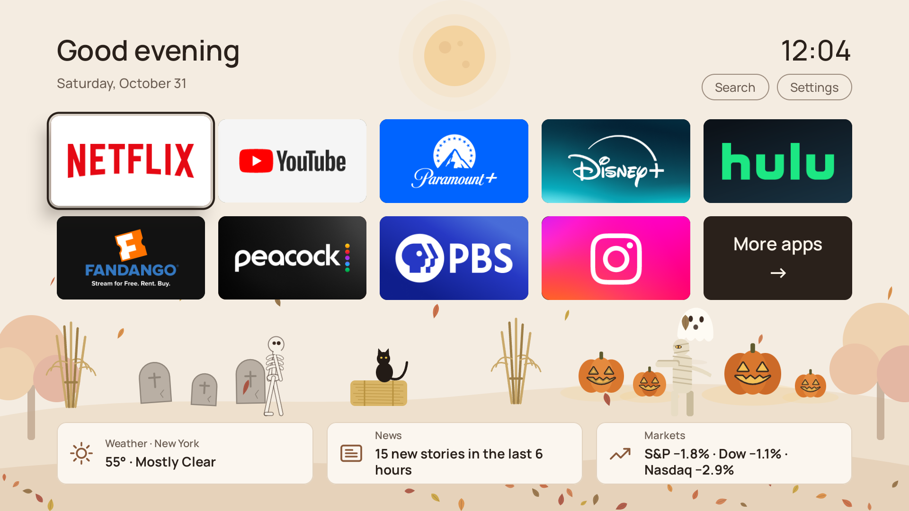

SimpleTV never plays video itself. Streaming apps are DRM-protected and have no APIs, so
SimpleTV opens them, or deep-links straight to a show inside them.

## What it does

- **App tiles.** Each app gets a big tile with its own logo banner. The apps you watch
  most move to the front, re-sorted at most once a day so nothing shifts while you're
  looking. Ten tiles fit on a page; a **More apps** tile slides in the next page.
- **Folders of shows.** Opening a streaming service shows a folder before the app itself:
  Continue Watching, Just Added, New Season, New Season Coming, and Top 10 Shows and
  Movies (Netflix's own Top 10, or the most popular titles elsewhere). Picking a show
  opens it inside its app.
- **YouTube folder.** It signs in once with a code you approve on your phone, then shows
  new videos from your subscriptions, your top channels, your liked videos and what's
  popular. Shorts are left out.
- **Movies.** Every movie out to watch at home in the US, on any service, newest first,
  or by popularity or score, in any genre. Each one shows its Rotten Tomatoes, IMDb and
  Metacritic scores and where it streams; OK opens it in your app, or Fandango at Home
  to rent or buy.
- **Search.** Type or speak to find a show, movie or actor. Each result says where it
  streams, including services that aren't on this TV.
- **At a glance.** Cards along the bottom show the weather, how many new news stories
  have come in, and the markets. Each card opens its own page: a 6-day forecast with
  weather alerts, the day's top stories, and the major indexes plus your own stocks,
  each with a detail page.
- **Family photo screensaver.** Free TV starts a slow slideshow of your own photos, and the
  same slideshow can be the TV's screensaver when it sits idle. Portrait photos show
  whole, over a soft blurred fill; Up and Down change how long each photo stays up. To
  add some, scan the QR code on the TV with any phone on the same Wi-Fi and pick photos.
  The TV resizes them itself, and the same page shows what's on the TV so you can remove
  photos. Photos stay on the TV; nothing goes to the cloud.
- **Every TV in the house shares.** TVs built with the same sync key find each other on
  the home Wi-Fi and share Continue Watching and the family photos, including removals,
  and carry other home apps' records between TVs (Trivia Night's players and scores).
  Each TV keeps its own app order.
- **Remote buttons that work.** The onn remote's app buttons, Star, Person, Settings,
  Free TV, channel and TV buttons get their jobs back once the stock home screen is
  gone:
  - The app buttons open their apps. While something's playing, they first ask
    "Switch to …?", so a bumped button doesn't interrupt the show.
  - ★ Star opens search, 👤 Person opens Continue Watching, and Free TV starts the photo
    screensaver.
  - Channel ▲ and ▼ are play and pause.
  - TV shows an info panel over whatever's playing.
- **Seasonal scenes.** Falling leaves in autumn, and decorations for holidays, like a
  Halloween graveyard with a walking skeleton. Each holiday's decorations come and go
  on their own.

## What you need

- A Walmart onn 4K Streaming Device (2026), or another Android TV 14+ device. SimpleTV is
  built and tested only on the onn, so its remote button codes are the onn remote's.
- A Mac, Windows or Linux computer with [Android Studio](https://developer.android.com/studio).
  Its bundled Java (JBR 21) builds the project.
- adb access to the TV. On the TV, turn on Developer options and Network debugging, then
  connect with `adb connect <tv-ip>:5555`.
- Free API keys for the data sources below.

## Setup

### 1. Add the API keys

Keys never go in the repo. The build reads them from files in your home folder and bakes
them into the app (`BuildConfig`). Each file holds just the value, or `name=value` lines
where shown.

| File | What it is | Where to get it |
|---|---|---|
| `~/.config/tmdb/read_token` | TMDB API read access token | [themoviedb.org](https://www.themoviedb.org/settings/api), free |
| `~/.config/watchmode/api_key` | Watchmode API key | [watchmode.com](https://api.watchmode.com/), free plan |
| `~/.config/youtube/credentials.txt` | `client_id=` and `client_secret=` lines | Google Cloud, see below |
| `~/.config/omdb/api_key` | OMDb API key as an `API_KEY=` line (optional, for movie scores) | [omdbapi.com](https://www.omdbapi.com/apikey.aspx), free |
| `~/.config/signalpost/api_key` | SignalPost API key (optional, for news) | SignalPost |
| `~/.config/simpletv/home.txt` | Your location and local news market | You, see below |
| `~/.config/simpletv/sync_key` | A random secret shared by your TVs (optional) | `openssl rand -hex 24` |

Keep them private, for example with `chmod 600`. Any feature whose key or setting is
missing turns itself off and says so on screen.

**`home.txt`** sets where the TV is:

```
# "latitude,longitude" for the US National Weather Service
weather_point=40.7128,-74.0060
# A SignalPost market id and the name to show for it (optional)
local_news_market=new-york
local_news_name=New York
```

**YouTube.** In the [Google Cloud console](https://console.cloud.google.com/):

1. Create a project and enable the **YouTube Data API v3**.
2. Under **Google Auth Platform**, set up the consent screen as **External** and add the
   `youtube.readonly` scope.
3. Fill in the Branding page, then **Publish** the app. If you skip this, Google signs the
   TV out every 7 days. You don't need verification for personal use; you'll see an
   "unverified app" warning once when you approve the code.
4. Create an OAuth client of type **TVs and Limited Input devices**, and put its ID and
   secret in `credentials.txt`.

### 2. Build and install

```bash
export JAVA_HOME="/Applications/Android Studio.app/Contents/jbr/Contents/Home"
./gradlew testDebugUnitTest assembleDebug
adb install -r app/build/outputs/apk/debug/app-debug.apk
```

The `JAVA_HOME` path above is for macOS; on Windows or Linux, point it at Android Studio's
`jbr` folder.

Steps 3 and 4 below are also one command: `scripts/setup-stick.sh <tv-ip>` installs the
APK, turns on the extras and makes SimpleTV the home screen. The stick can drop off Wi-Fi
when its home screen changes; wake it and run the script again. To copy the family
photos from one TV to another, run `scripts/copy-photos.sh <from-ip> <to-ip>`.

### 3. Make it the home screen

SimpleTV answers the Home button, but the stock Google TV home screen has to step aside
first:

```bash
adb shell pm disable-user --user 0 com.google.android.apps.tv.launcherx
adb shell pm disable-user --user 0 com.google.android.tungsten.setupwraith
```

To go back to the stock home screen, run `adb shell pm enable` on the same two packages.
A system update may turn them back on.

### 4. Turn on the extras

```bash
# Remote buttons (an accessibility service; it sees remote buttons only, never screen content)
adb shell settings put secure enabled_accessibility_services com.redmesastudios.simpletv/.RemoteButtons
adb shell settings put secure accessibility_enabled 1

# Most-watched apps first (reads how long each app was on screen)
adb shell appops set com.redmesastudios.simpletv GET_USAGE_STATS allow

# Voice search through the remote's microphone (or accept the prompt on first use)
adb shell pm grant com.redmesastudios.simpletv android.permission.RECORD_AUDIO

# Your family photos as the TV's screensaver (undo with: settings delete secure screensaver_components)
adb shell settings put secure screensaver_components com.redmesastudios.simpletv/.PhotoDream
```

It also helps to set the TV's sleep timer to **Never**. The onn drops off Wi-Fi in
standby, and adb can't reach it there.

## Making it yours

- **Apps.** Every installed TV app gets a tile. `StreamingApps.kt` lists the known
  services, in their starting order, with each service's TMDB and Watchmode IDs; other
  apps follow by name.
- **Remote buttons.** `buttonAction()` in `RemoteButtons.kt` maps key codes to jobs. Other
  remotes send different codes for their extra buttons.
- **Holidays.** `Holidays.kt` decides which decorations show on which dates, and each
  holiday draws its own scene (see `HalloweenScene.kt`).

`CLAUDE.md` has a fuller map of the code.

## Data sources

- [TMDB](https://www.themoviedb.org/): show and movie details, artwork, search, and
  where things stream. *This product uses the TMDB API but is not endorsed or certified
  by TMDB.*
- [OMDb](https://www.omdbapi.com/): Rotten Tomatoes, IMDb and Metacritic scores for
  movies.
- [Watchmode](https://www.watchmode.com/): new releases per service and the web links
  that open shows in their apps.
- Netflix's public [Top 10](https://www.netflix.com/tudum/top10) pages.
- [YouTube Data API](https://developers.google.com/youtube/v3): your subscriptions,
  liked videos and popular videos.
- [National Weather Service](https://www.weather.gov/documentation/services-web-api):
  forecasts and alerts (US only).
- [SignalPost](https://signalpost.redmesastudios.com): news stories ranked by how many
  newsrooms cover them.
- Yahoo Finance's public chart data, for indexes and stocks. It's unofficial and could
  change without notice.

## A note on privacy

Your API keys are baked into the app you build. That's fine for your own TV, but don't
share your APK. Watch history, the YouTube sign-in and your stock list stay on the TV.

## Screenshots

All from the onn stick, in the fall theme. Select one to see it full size.

<table>
<tr><td width="50%"><a href="docs/screenshots/folder-disney.jpg">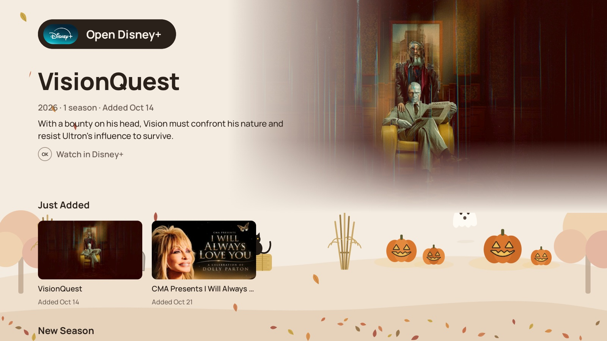</a><br><sub>A service's folder: open the app, or pick a show to open it inside the app.</sub></td><td width="50%"><a href="docs/screenshots/folder-popular.jpg">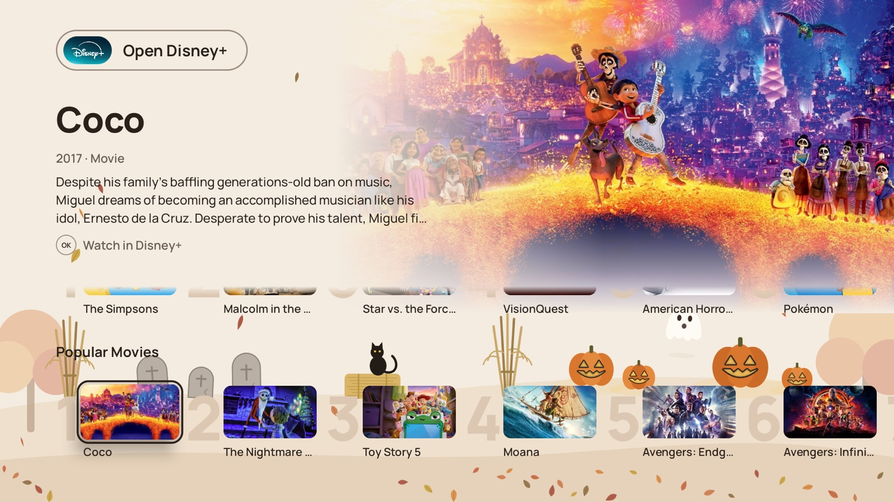</a><br><sub>Popular shows and movies on the service, ranked.</sub></td></tr>
<tr><td width="50%"><a href="docs/screenshots/folder-top10.jpg">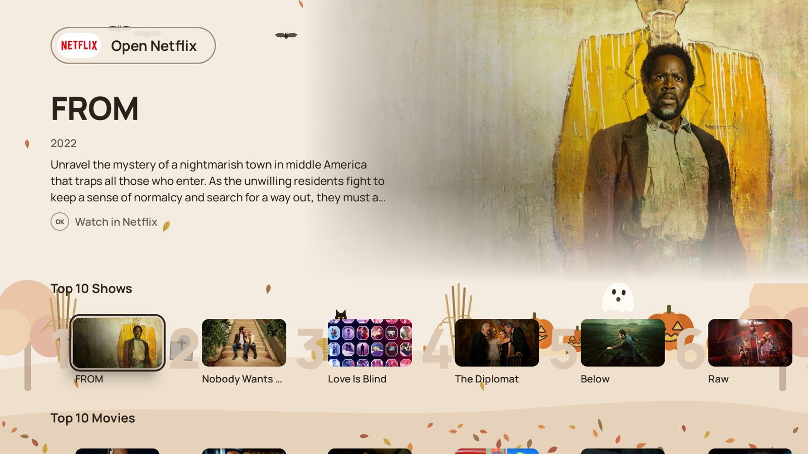</a><br><sub>Netflix's own Top 10.</sub></td><td width="50%"><a href="docs/screenshots/folder-coming.jpg">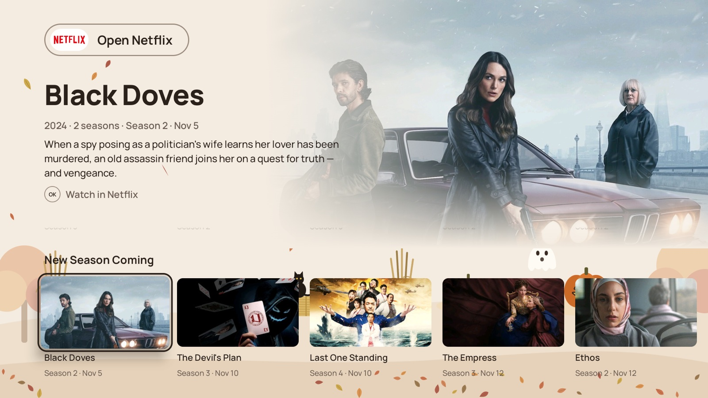</a><br><sub>New seasons on the way, with their dates.</sub></td></tr>
<tr><td width="50%"><a href="docs/screenshots/search.jpg">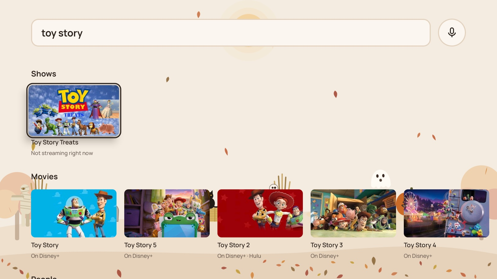</a><br><sub>Search by typing or voice; each result says where it streams.</sub></td><td width="50%"><a href="docs/screenshots/weather.jpg">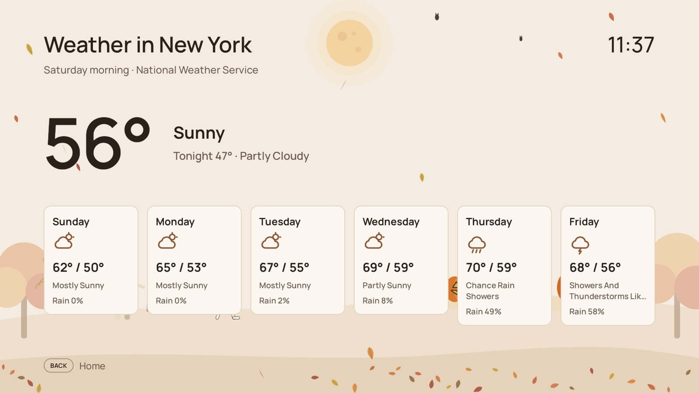</a><br><sub>Weather: now, alerts and six days.</sub></td></tr>
<tr><td width="50%"><a href="docs/screenshots/weather-day.jpg">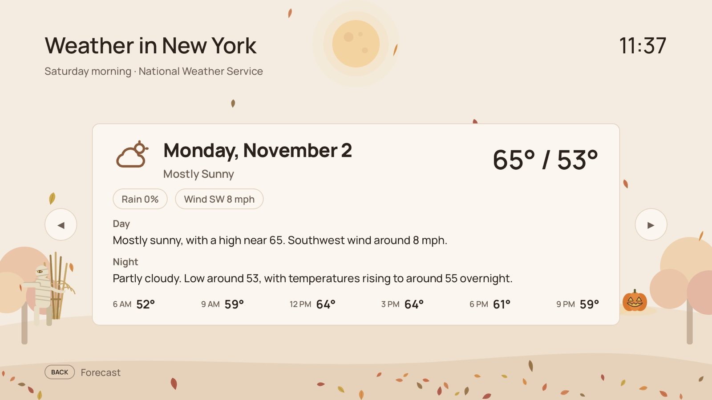</a><br><sub>One day in full; Left and Right step through the days.</sub></td><td width="50%"><a href="docs/screenshots/news.jpg">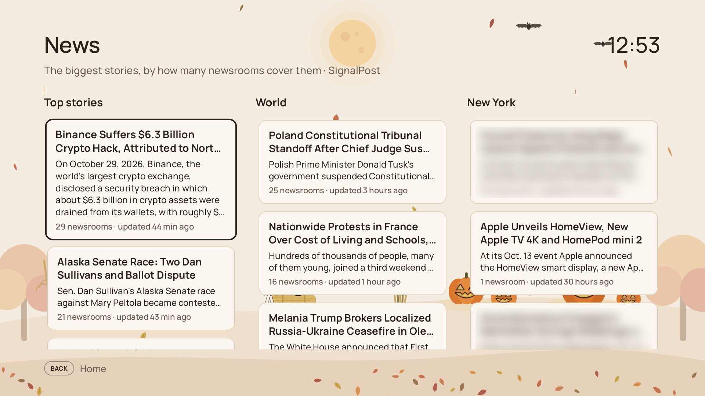</a><br><sub>News, ranked by how many newsrooms cover each story.</sub></td></tr>
<tr><td width="50%"><a href="docs/screenshots/news-story.jpg"></a><br><sub>A story in full.</sub></td><td width="50%"><a href="docs/screenshots/markets.jpg">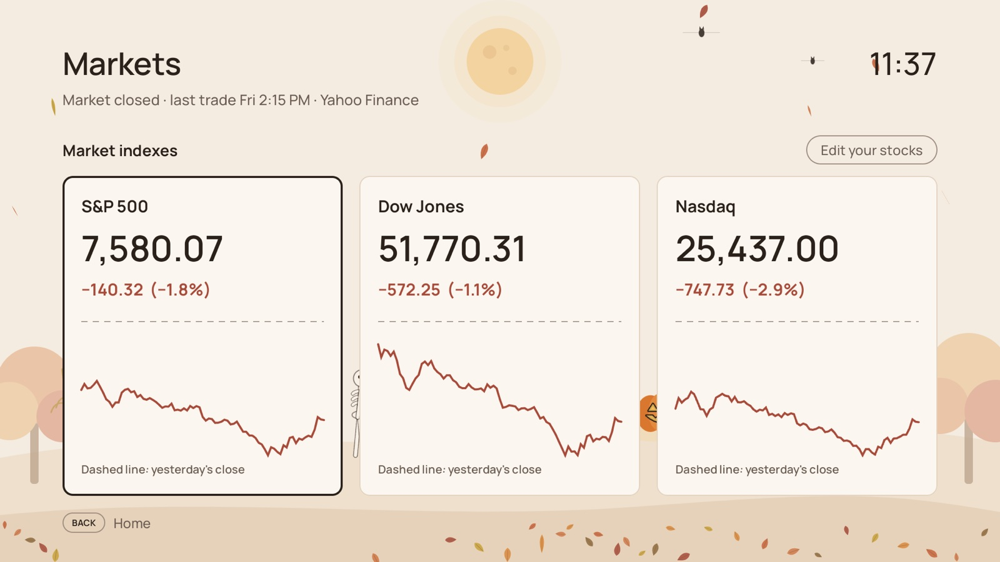</a><br><sub>Markets: the major indexes, then your own stocks.</sub></td></tr>
<tr><td width="50%"><a href="docs/screenshots/market-detail.jpg">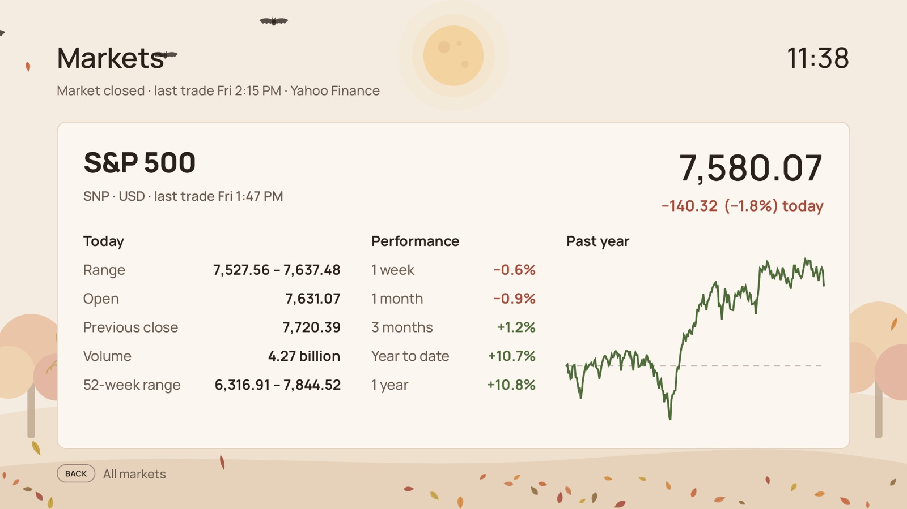</a><br><sub>A market's day, its year and how it's done lately.</sub></td><td></td></tr>
</table>

## License

SimpleTV is released under the MIT License; see `LICENSE`. The Manrope typeface it
bundles is under the SIL Open Font License; see `FONT-LICENSE-OFL.txt`.
